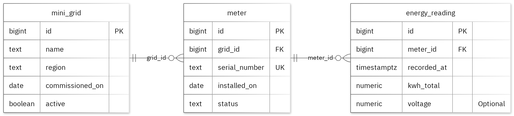

# MIT 8103 Advanced Database Systems

**Solar Mini-Grid Energy Distribution and Meter Monitoring System** · Aisha Abubakar · Student ID 301924398

## Case study

For this portfolio, I chose a Solar Mini-Grid Energy Distribution and Meter Monitoring System as my case study. The database is aimed at two groups of users: the mini-grid operators who manage the grids day to day, and the monitoring analysts who review how energy is being used. I built it around three separate tables: mini_grid, meter and energy_reading. With this structure, a user can register a meter to a mini-grid using its unique serial number, record timestamped energy readings, check the status of each meter, look up readings for a particular grid over a chosen time period, and summarise energy use by grid and by day.

## Portfolio 1: Database Design and Modelling

I split the relational design into three tables. Each table has a primary key so every record can be identified, and foreign keys keep the links between grids, meters and readings intact. I also added check constraints to enforce the business rules. For example, a cumulative kWh reading can never be negative, so it must be zero or greater. My normalisation examples take the sample data through 1NF, 2NF and 3NF to show how the design was reached. To test the constraints, I tried nine inserts that I knew were invalid. The database rejected all nine, and none of the valid sample rows were changed.

Figure 1. Tables, keys and relationships. PK: primary key; FK: foreign key; UK: unique value.

<!-- PAGE BREAK -->

## Portfolio 2: Query Processing and Optimisation

I ran four SQL queries against the sample records. The join query returned two rows, one of which was Sunrise Mini-Grid with meter MTR-SUN-001. To see how much difference an index makes, I created a separate set of 20,000 performance rows rather than using the sample data. After the index was added, the median lookup time dropped from 1.003 ms to 0.191 ms. Both runs returned exactly the same records, and the execution plan confirmed that the second run actually used the new index. I should point out that these timings only apply to this particular lookup in my test environment, so they shouldn't be read as a general benchmark.

## Portfolio 3: Transactions and Concurrency

To test COMMIT, ROLLBACK and READ COMMITTED isolation, I added a temporary counter to the meter table. When one session updated the counter without committing, the other session couldn't see the change, and running ROLLBACK put the counter back to its previously committed value. I then ran two increments at the same time. Without any locking, the counter ended at 2, which meant one of the updates had been lost. When I repeated the test using SELECT FOR UPDATE, Session B had to wait until Session A finished, and the counter correctly ended at 3. I only used this counter for this exercise, and the original business fields in the case study were left untouched.
## Portfolio 4: NoSQL and Advanced Data Models

For the event documents in my case study, I created a MongoDB collection called meter_events. I inserted four sample events and ran four queries against them, and each query gave the result I expected. I also tested the validation rules: MongoDB rejected one document because its date was the wrong type, and rejected another because it reused an existing event ID. One benefit of this model is that embedded snapshots store the related details inside each event document, and the details field can change shape depending on the type of event. All of these events are fictional. Using MongoDB here doesn't replace PostgreSQL, which still enforces the relational rules for the core data.

## Repository and evidence

https://github.com/aaaesher/Abubakar_Aisha_301924398

The portfolio folders contain the SQL and JavaScript, explanations, query plans, result tables and screenshots.

<!-- PAGE BREAK -->

## Portfolio 5: Distributed and Cloud Database Exercise

For this part, I proposed a MongoDB replica set with three members, each placed in a separate failure zone. My discussion covers how a primary is elected, why writes should be acknowledged by a majority, what happens when secondaries fall behind, and the trade-offs involved in sharding the meter_events collection. A key point is that replication keeps the system available, but it isn't a backup, so backups are still needed for recovery. PostgreSQL would also need its own availability plan. I took the discussion-based option allowed for this task, so I didn't deploy a live replica set or run a failover test.

## Individual reflection
I kept mini_grid, meter and energy_reading as separate tables so each set of details could be updated in one place rather than copied into every related record. The rule that a cumulative kWh reading must be zero or greater was a key part of the design, and my constraint tests checked it along with the required fields and the links between records. The two-session exercise showed me how easily concurrent updates can go wrong. Both sessions can read the same value before either one commits, so one update ends up overwriting the other. Locking the row before reading it fixed this and kept both increments. The index comparison also taught me to look at the execution plan and not just the final answer, because two queries can return the same result while making the database do very different amounts of work.

## AI-use declaration

I used GitHub Copilot and the portfolio generator to help me prepare the database model, the scripts and the explanations. The generator ran the PostgreSQL and MongoDB exercises, checked their outputs and captured the result images. I am still responsible for checking the submitted work and being able to explain it.
## References

- [PostgreSQL: constraints](https://www.postgresql.org/docs/17/ddl-constraints.html)
- [PostgreSQL: EXPLAIN](https://www.postgresql.org/docs/17/using-explain.html)
- [PostgreSQL: isolation](https://www.postgresql.org/docs/17/transaction-iso.html)
- [PostgreSQL: row locks](https://www.postgresql.org/docs/17/explicit-locking.html)
- [MongoDB: data modelling](https://www.mongodb.com/docs/manual/data-modeling/)
- [MongoDB: replication](https://www.mongodb.com/docs/manual/replication/)
- [MongoDB: sharding](https://www.mongodb.com/docs/manual/sharding/)
- [Mermaid: ER diagrams](https://mermaid.js.org/syntax/entityRelationshipDiagram.html)

