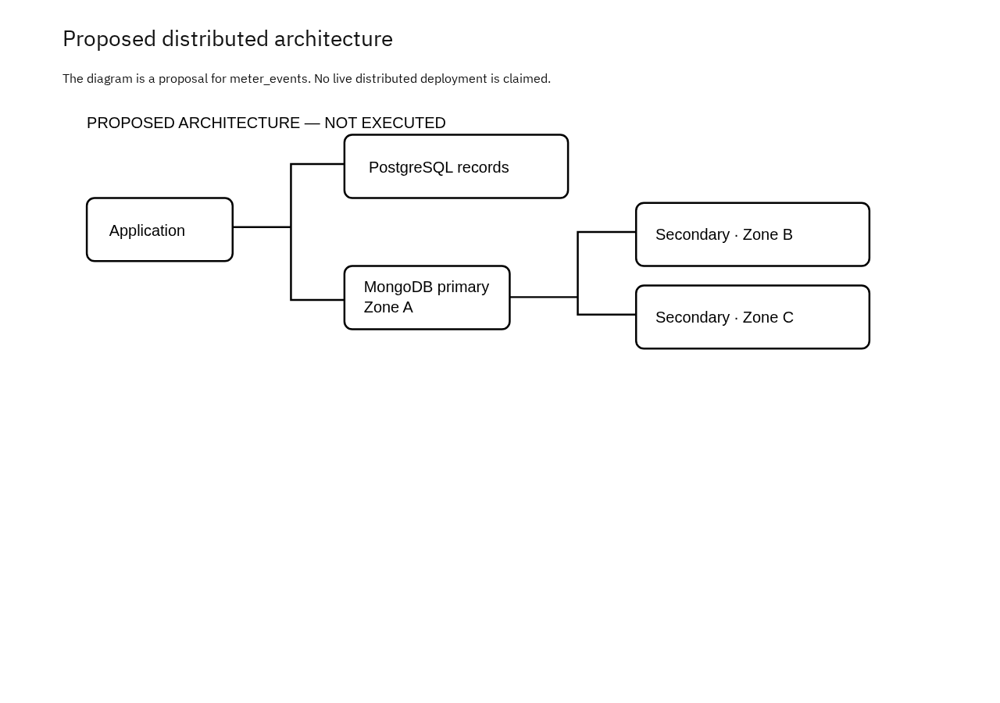

# Solar Mini-Grid Energy Distribution and Meter Monitoring System — Portfolio 5

This is the proposed distributed design for the case study.

## Case and proposed deployment

In the Solar Mini-Grid Energy Distribution and Meter Monitoring System, the relational records are stored in PostgreSQL, while MongoDB holds the meter_events collection. In the proposed design, each event document identifies the meter and the event type and records when the event happened. Reading events also include an embedded energy_reading payload. Optional event-specific attributes give the model room to handle telemetry and alert details that vary from one event to another. In the proposed deployment, the application connects to a three-member MongoDB replica set spread across three availability zones within a single region. PostgreSQL would need its own managed high-availability configuration. The two databases are separate, and a MongoDB replica set does not replicate PostgreSQL data.

## Replication and availability

In a replica set, a single primary accepts all writes, and the two secondaries copy its oplog asynchronously. If the primary fails, the eligible members can elect a replacement, provided that a voting majority is still available. Writes may pause briefly while the election takes place. If a network partition leaves a group of members without a majority, that group cannot elect a primary. Physical separation also matters. Running all three members as containers on one computer would not protect the system if that computer failed.
## Consistency and the case

For meter_events, I propose a client policy that uses majority write concern with a finite timeout. Reads would go to the primary, with majority read concern used wherever the application needs committed data. Reads from secondaries can return slightly out-of-date data because secondaries may lag behind the primary. When the application retries a write, it should include an idempotency key so that the same event is not recorded twice. PostgreSQL constraints remain the authoritative source for the rule that each meter serial number identifies at most one registered meter. These settings do not provide an atomic transaction across PostgreSQL and MongoDB. Achieving that kind of coordination would require a separate implementation, such as an outbox pattern with a retrying consumer.
## Sharding trade-off

Sharding and replication serve different purposes. Sharding partitions documents across servers, while replication copies them to keep the system available. The small sample used in this portfolio does not need sharding. If meter_events grows large, a high-cardinality source-record identifier could be evaluated as a hashed shard key, tested against the actual query and write patterns. Each option involves a trade-off. A shard key based only on an increasing time value tends to send all new writes to the same shard. A hashed key spreads writes more evenly, but time-range queries may then have to contact several shards. Data distribution and query plans should therefore be validated before a shard key is chosen.

## Cloud deployment and recovery

A production deployment would need private networking, authentication, least-privilege roles, TLS encryption, monitoring and regularly tested backups. Replication does not replace backups, because it copies accidental deletions to every member just as faithfully as it copies valid changes. Likewise, availability zones protect against failures within a region but do not provide disaster recovery if the whole region is lost. This is a discussion-based design only. No cloud service was provisioned, and no failover, replication, sharding or recovery experiments were carried out.
## References

- [MongoDB: replication](https://www.mongodb.com/docs/manual/replication/)
- [MongoDB: sharding](https://www.mongodb.com/docs/manual/sharding/)

